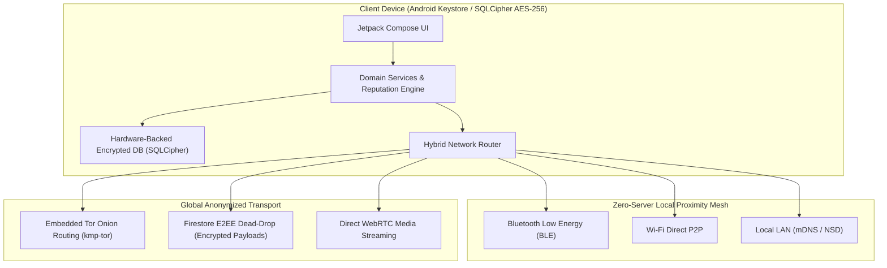

# Clear Space 🌐🔒

[](https://developer.android.com)
[](https://kotlinlang.org)
[](https://developer.android.com/jetpack/compose)
[](https://www.torproject.org/)
[](https://fastlane.tools/)
[](https://www.gnu.org/licenses/agpl-3.0)

> **Clear Space** is a decentralized, hybrid content-sharing platform and peer-to-peer social network. The user maintains absolute cryptographic sovereignty over what is shared, what remains private, and network interactions. Built for Android with Jetpack Compose, embedded Tor onion routing, and local zero-server proximity mesh.

---

## 🏗️ System Architecture



---

## ⚡ Core Architecture & Features

1. **Hybrid Network Topology**:
   - **Local Public Network**: Public content operates on a zero-server mesh network. It broadcasts locally via Bluetooth Low Energy (BLE), Wi-Fi Direct, and Local LAN (mDNS/NSD).
   - **Global Trusted Sync**: Content shared with Trusted Contacts or Groups is routed globally over the internet via embedded Tor (`kmp-tor`) and encrypted WebRTC channels.
2. **Minimal Cloud Footprint**: Firebase Firestore acts purely as an End-to-End Encrypted (E2EE) "dead drop" for asynchronous message exchange—zero plaintext is ever accessible remotely.
3. **Hardware-Backed Encryption**: All data is encrypted at rest using SQLCipher (AES-256-GCM) with master keys securely bound to the Android Keystore's StrongBox / Trusted Execution Environment (TEE).
4. **Decentralized Reputation & Anti-Abuse**:
   - Cryptographic Proof-of-Work (PoW) token-voting system ensures Sybil resistance and prevents duplicate voting without requiring centralized user identification.
   - Dynamic client-side consensus automatically prunes malicious or policy-violating content once localized report thresholds are verified.
5. **Physical Device Attestation**: Emulators and virtual device farms are restricted via hardware integrity checks to eliminate bot networks.

---

## 📂 Repository Structure

```text
├── app/                        # Main Android application module (Jetpack Compose, Domain, DI)
├── kmp-tor-sources/            # Embedded Tor onion routing integration layer
├── kmp-tor-resource-sources/   # Native Tor runtime binaries and assets
├── fastlane/                   # Automated store release and screenshot pipelines
├── scripts/                    # PowerShell release framing and automated capture utilities
├── CONTRIBUTING.md             # Contribution guidelines & coding conventions
├── PRIVACY.md                  # Comprehensive privacy & cryptographic guarantees
└── build.gradle.kts            # Project root build script
```

---

## 🛠️ How to Build

### Prerequisites
- Android Studio Ladybug or newer
- Android SDK (API 36, Build Tools 36.0.0)
- Java 17+ (e.g., via SDKMAN / OpenJDK)

### Compilation
```bash
# Clone the repository
git clone https://github.com/Etherdancer/ClearSpace.git
cd ClearSpace

# Build debug APK:
./gradlew assembleDebug

# Build release APK:
./gradlew assembleRelease
```

---

## 🤝 Open Source & Acknowledgements

Clear Space is inspired by and incorporates patterns from leaders in privacy engineering:
- **[CoffeeHouseInfo](https://github.com/coffeehouseinfo):** Decentralized, anonymous `ReputationAgent` and PoW token voting.
- **[kmp-tor](https://github.com/05nelsonm/kmp-tor):** Embedded Tor controller and daemon for Kotlin Multiplatform / Android.
- **[Signal Protocol](https://signal.org/):** End-to-end cryptographic ratcheting patterns.
- **[SQLCipher](https://www.zetetic.net/sqlcipher/):** Full database encryption at rest.

---

## 📄 License

This project is licensed under the **GNU Affero General Public License v3.0**. See the [LICENSE](LICENSE) file for details.
